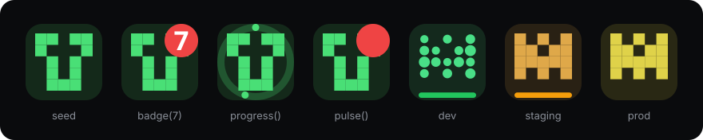

# favipulse

[](https://www.npmjs.com/package/favipulse)
[](https://github.com/MrLouisWright/favipulse/actions/workflows/ci.yml)
[](https://nodejs.org)
[](LICENSE)


> Favicons that say something: who, where, and what's happening.

**[Live demo →](https://mrlouiswright.github.io/favipulse/)** · [Docs (wiki)](https://github.com/MrLouisWright/favipulse/wiki) · [Migrating from favico.js / tinycon](https://github.com/MrLouisWright/favipulse/wiki/Migrating-from-favico.js-and-tinycon)

<p align="center"></p>

`favipulse` draws a **deterministic generative favicon** from any seed (with an optional **self-drawing** animation), shows **badges**, a **progress ring** for builds and uploads and a **pulse** when something needs attention, and gives **dev, staging and prod their own icon** so you never ship from the wrong tab again. A CLI and Vite / Next.js helpers generate static `favicon.svg`, `favicon.ico`, PNG sizes and a manifest snippet per environment.

Under 3.1 KB min+gzip, zero dependencies, TypeScript types, ESM + CJS, SSR-safe, works without canvas (pure SVG) and respects `prefers-reduced-motion`. A modern, maintained replacement for [favico.js](https://github.com/ejci/favico.js) (~43k downloads/week, last release 2015) and [tinycon](https://github.com/tommoor/tinycon) (~11k/week, last release 2017).

## Install

```bash
npm i favipulse
```

Or from a CDN, no build step: `<script src="https://unpkg.com/favipulse"></script>` → `window.favipulse`.

## Usage

```js
import { favipulse } from 'favipulse';

const fav = favipulse({ seed: 'acme', env: 'auto' }); // dev/staging/prod detected from the hostname
await fav.draw();          // self-drawing intro (instant with reduced motion)

fav.badge(3);              // unread count; 0 hides, >99 shows 99+
fav.badge('!');            // or short text
fav.progress(0.42);        // progress ring (0-1 or 0-100)
fav.progress(null);        // hide it
fav.pulse();               // pulsing halo; fav.pulse(false) to stop
fav.reset();               // clear badge, progress, pulse
fav.destroy();             // restore the original favicon
```

### Progress during an upload

```js
const fav = favipulse();
xhr.upload.onprogress = (e) => fav.progress(e.loaded / e.total);
xhr.onloadend = () => fav.progress(null).badge('✓');
```

### Static favicon sets per environment (CLI)

```bash
npx favipulse generate --seed acme --out public/favicons
# ✔ dev      10 files → public/favicons/dev/
# ✔ staging  10 files → public/favicons/staging/
# ✔ prod     10 files → public/favicons/prod/
```

Each folder holds `favicon.svg`, `favicon.ico` (16/32/48), `favicon-16x16.png`, `favicon-32x32.png`, `favicon-48x48.png`, `apple-touch-icon.png` (180), `icon-192.png`, `icon-512.png`, `manifest.webmanifest` and a `head.html` snippet to paste into `<head>`. PNGs are rasterised in pure JS, so no sharp, canvas or ImageMagick needed.

| Option | Description |
|---|---|
| `--seed <text>` | Seed for the icon, e.g. your app name (required) |
| `--env <list>` | Comma-separated environments (default `dev,staging,prod`) |
| `--out <dir>` | Output directory, one sub-folder per environment (default `favicons`) |
| `--flat` | With a single `--env`, write straight into `--out` |
| `--style grid\|dots\|rings` | Pattern style (default: per-environment preset) |
| `--hue`, `--fg`, `--bg`, `--radius` | Colour and shape overrides |
| `--name`, `--base` | Manifest name and URL prefix for snippets |
| `--small` | Only svg, ico and 16/32/48 PNGs |
| `--json` | Machine-readable summary |

`npx favipulse svg --seed acme --env dev` prints a single SVG to stdout.

### Vite

```js
// vite.config.js
import favipulse from 'favipulse/vite';
export default { plugins: [favipulse({ seed: 'acme' })] };
```

Emits the set for the current mode (`development` → dev, `staging` → staging, otherwise prod), serves it in dev, and replaces the `<link rel="icon">` in `index.html`. Pass `env: (mode) => ...` to map your own modes and `dir: 'icons'` for a sub-folder.

### Next.js (App Router)

```ts
// app/layout.tsx
import { faviconMetadata } from 'favipulse/next';
export const metadata = { icons: faviconMetadata({ seed: 'acme' }) }; // env from VERCEL_ENV / NEXT_PUBLIC_APP_ENV / NODE_ENV

// or app/icon.svg/route.ts
import { iconRoute } from 'favipulse/next';
export const GET = iconRoute({ seed: 'acme' });
```

For live badges in a client component: `useEffect(() => { const f = favipulse({ seed: 'acme' }); f.badge(count); return () => f.destroy(); }, [count])`.

## API

### `favipulse(options?) → Favipulse`

| Option | Default | Description |
|---|---|---|
| `seed` | `location.host` | Any string. Same seed, same icon, everywhere |
| `env` | — | `'dev'`, `'staging'`, `'prod'`, a custom name, or `'auto'` (from hostname) |
| `style` | `'grid'` | `'grid'` (mirrored identicon), `'dots'`, `'rings'` |
| `hue` / `fg` / `bg` / `radius` | from seed | Colour overrides; `bg: 'transparent'` for no tile |
| `badge`, `badgeBg`, `badgeFg` | — / `#ef4444` / `#fff` | Initial badge and colours |
| `progress`, `ringColor` | — / icon colour | Initial progress and ring colour |
| `pulse` | `false` | Start pulsing immediately |
| `stripe` | env preset | Colour of the environment stripe |
| `format` | `'svg'` | `'svg'`, `'png'` (canvas, falls back to SVG), `'auto'` (PNG only on Safari) |
| `size` | `64` | PNG size when using canvas |
| `reducedMotion` | `true` | Honour `prefers-reduced-motion: reduce` |
| `fps` | `12` | Animation frame rate (favicons don't need 60) |
| `document` | global | Target document (iframes, tests) |

Methods (chainable): `badge(v, colours?)`, `progress(v)`, `pulse(on = true)`, `draw(ms = 900): Promise`, `set(options)`, `reset()`, `destroy()`. Properties: `svg` (current markup), `link` (the managed `<link>`).

### Pure helpers (no DOM, safe in Node / workers / SSR)

| Export | Description |
|---|---|
| `icon(seed, opts?)` | Deterministic icon model (shapes in a 64×64 box) |
| `toSVG(icon, overlay?)` | SVG markup with optional `badge`, `progress`, `pulse`, `reveal`, `stripe` |
| `dataURI(svg)` | `data:image/svg+xml,...` for `<link rel="icon">` |
| `envIcon(seed, env)`, `envSVG(seed, env)` | Environment variants; presets in `ENVS` (add your own) |
| `detectEnv(hostname?)` | `localhost`/`*.local`/`*.test` → dev; `staging.`/`preview`/`*.vercel.app`/`*.netlify.app`/`*.pages.dev` → staging; else prod |
| `hash`, `rng`, `hsl`, `badgeText`, `svgToPNG` | Building blocks |

`favipulse/node`: `generate(options)` → `{ [file]: Buffer | string }`, `writeSet(dir, files)`, `rasterize`, `encodePNG`, `encodeICO`.
`favipulse/compat`: `Favico` and `Tinycon` drop-in shims.

## Compared

| | favipulse | favico.js | tinycon |
|---|---|---|---|
| Last release | 2026 | 2015 (0.3.10) | 2017 (0.6.8) |
| Size (min+gzip) | 2.9 KB (more features) | 3.0 KB | 1.5 KB |
| TypeScript types | ✔ built in | ✖ | ✖ |
| ESM + CJS | ✔ | ✖ UMD | ✖ UMD |
| Works without canvas / SSR-safe | ✔ SVG | ✖ | ✖ |
| Badges | ✔ | ✔ | ✔ |
| Progress ring | ✔ | ✖ | ✖ |
| Generated icon from a seed | ✔ + self-drawing | ✖ | ✖ |
| Per-environment icons | ✔ | ✖ | ✖ |
| `prefers-reduced-motion` | ✔ | ✖ | n/a |
| Static svg/ico/png + manifest CLI | ✔ | ✖ | ✖ |
| Vite / Next.js helpers | ✔ | ✖ | ✖ |
| Images, video, webcam in favicon | ✖ | ✔ | ✖ |

## Migrating from favico.js / tinycon

Quickest path: swap the import for the shim, then refactor at leisure.

```js
// favico.js
import { Favico } from 'favipulse/compat';
const favicon = new Favico({ animation: 'pop', bgColor: '#5CB85C' });
favicon.badge(12); favicon.reset();

// tinycon
import { Tinycon } from 'favipulse/compat';
Tinycon.setOptions({ background: '#549A2F' }); Tinycon.setBubble(6);
```

| favico.js | favipulse |
|---|---|
| `new Favico(opts)` | `favipulse({ badgeBg, badgeFg })` |
| `.badge(n)` | `.badge(n)` |
| `.reset()` | `.reset()` |
| `animation: 'pop' \| 'fade' \| ...` | `.pulse()` (reduced-motion aware) |
| `.image()`, `.video()`, `.webcam()` | not supported (use a seed icon) |

| tinycon | favipulse |
|---|---|
| `Tinycon.setBubble(n)` | `fav.badge(n)` |
| `Tinycon.setOptions({ background, colour })` | `favipulse({ badgeBg, badgeFg })` |
| `fallback: 'force'` (title) | compat shim keeps it; core never needs a fallback |
| `Tinycon.reset()` | `fav.reset()` |

Full guide: [wiki/Migrating from favico.js and tinycon](https://github.com/MrLouisWright/favipulse/wiki/Migrating-from-favico.js-and-tinycon).

## Browser support

SVG favicons: Chrome, Edge, Firefox, Opera. Safari doesn't render SVG favicons, so use `format: 'auto'` (PNG via canvas on Safari) and ship the static `favicon.ico` from the CLI as the baseline. Without canvas (jsdom, locked-down contexts) favipulse keeps the SVG.

## Limitations

Browsers throttle favicon updates in background tabs, so animations are best-effort there. Badges use the system font, so glyphs vary slightly by OS. The deterministic pattern uses 15 bits, so with thousands of seeds you'll see repeats; colour and style make collisions unlikely in practice.

## Releasing

Tag `vX.Y.Z` and publish a GitHub release: `release.yml` tests, then publishes to npm with provenance (enabled by the `NPM_PUBLISH` repository variable) and to GitHub Packages as `@mrlouiswright/favipulse`.

## Support

If this project is useful to you, you can support its development with a donation: [Buy me a coffee](https://donate.stripe.com/aFa00lek3cvX4Ds2Fk9EI0b). It helps keep these tools maintained, documented and free for everyone.

## Optional credit link

MIT needs no attribution. If you want a small backlink in the page:

```js
favipulse({ seed: 'acme', credit: true });
// or: creditTarget: '#footer' / an HTMLElement
```

Style it yourself (no inline styles are set):

```css
.favipulse-credit { font-size: 0.75rem; opacity: 0.65; }
```

`destroy()` removes the link. Off by default; no network calls or tracking.

## Credit (optional)

Free to use under MIT, no attribution required. If favipulse helps you, a link back is appreciated:

```html
<a href="https://louiswright.co.uk">Built with favipulse by Louis Wright</a>
```

```markdown
[](https://louiswright.co.uk)
```

## License

MIT © Louis Wright ([Louis Wright](https://github.com/MrLouisWright))
